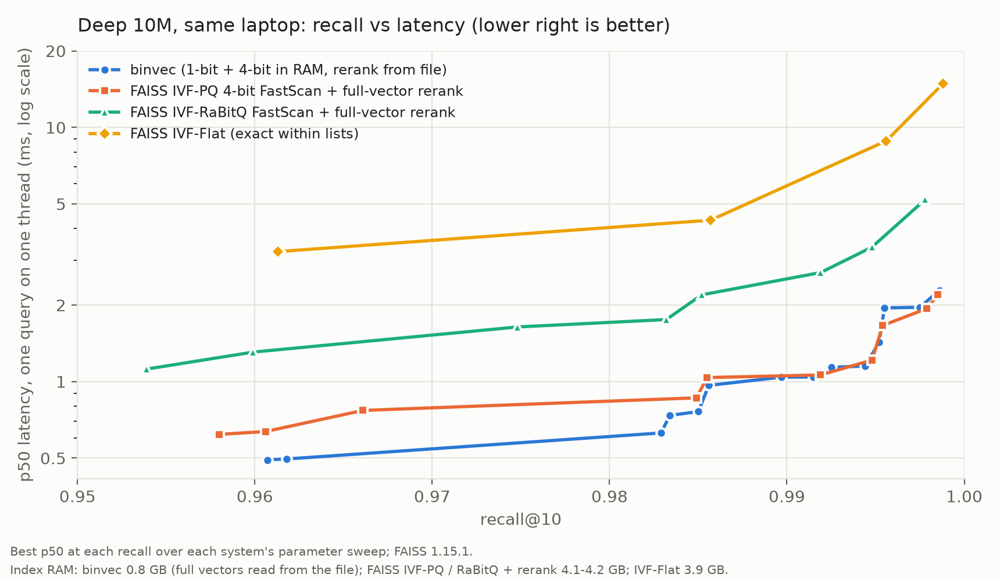

# binvec

Approximate nearest-neighbour search over large vector sets on a single machine, written in Rust.

> **Deep 100M on a laptop: 0.995 recall@10 at 10 ms p99** (median of 3 cold-cache runs), reading
> only 50 full vectors from SSD per query. In RAM: a 2.4 GB 1-bit index plus a 5.6 GB 4-bit
> refine tier; the 38 GB of full vectors stay on disk.
> Deep 10M: 0.995 recall@10 at 2.0 ms p99.
> **Filtered** (only vectors with a given label, from 50% of the data down to 0.01%): recall@10
> ≥ 0.99 at ≤ 21 ms p99 on Deep 100M. Searching first and filtering after drops to 0.49 at 10%
> and 0.001 at 0.01%.
> **Against FAISS** (Deep 10M, same laptop): as fast as FAISS's fastest IVF index per query at
> 0.985–0.999 recall, with 5× less RAM; FAISS has higher batch throughput.

Every number below comes from a CSV in `results/`, written by `binvec bench`, with ground truth
from the [NeurIPS'21 Big-ANN benchmark](https://big-ann-benchmarks.com/neurips21.html).
Machine: Dell Inspiron 16 7610, i7-11800H (8 cores), 16 GB RAM, NVMe SSD, WSL2 (Kali) with 11 GB
given to Linux, on mains power. Latency is one query at a time on one thread; QPS uses 16 threads.

## Results (v0.7)

### Deep 100M, cold cache

"Cold" = the Linux page cache is emptied and a fresh process starts before every run, so the
full vectors really come from disk. The ceiling is the best recall possible at that nprobe: the
share of true neighbours inside the probed clusters.

**3 runs each, alternating order** (recall over 2,000 queries, latency over 500)

| nprobe | refine | rerank (disk reads) | recall@10 | ceiling | median p50 ms | median p99 ms | p99 range ms | QPS |
|---|---|---|---|---|---|---|---|---|
| 64 | 2,000 | 20 | 0.971 | 0.975 | 3.4 | 5.4 | 3.4 – 5.9 | 1,911 |
| 128 | 5,000 | 50 | 0.989 | 0.991 | 4.9 | 7.5 | 5.9 – 7.8 | 1,007 |
| 256 | 5,000 | 50 | **0.995** | 0.997 | 7.0 | **9.9** | 9.6 – 10.6 | 682 |
| 256 | 10,000 | 50 | 0.995 | 0.997 | 7.3 | 10.6 | 10.1 – 11.8 | 603 |
| 512 | 10,000 | 50 | 0.997 | 0.999 | 12.7 | 19.0 | one run | 346 |

(`results/phase2-100M-repeats.csv` for nprobe 64; `results/phase2b-repeats.csv` for the rest.)

**v0.4 → v0.5, same settings, same session, alternating runs** (`results/phase2-100M-repeats.csv`)

| nprobe / refine / rerank | recall@10 | p50 ms | p99 ms | scan ms | QPS |
|---|---|---|---|---|---|
| 64 / 2,000 / 20 | 0.971 | 6.7 → **3.4** | 11.9 → **5.4** | 5.6 → 1.8 | 694 → 1,911 |
| 128 / 5,000 / 50 | 0.989 | 13.1 → **5.2** | 21.4 → **9.1** | 10.7 → 3.0 | 297 → 863 |

The old path is v0.4's byte-table scan and heap, run from the v0.5 binary (so it already has the
faster refine stage). v0.4 as originally measured was 16.5 and 28.9 ms median p99
(`results/phase1b-repeats.csv`). Recall is identical to four decimals at every setting tested.

One run in the grid (`results/phase2-100M-grid.csv`, nprobe 256 / refine 5,000) had a 116 ms
p99; three repeats of the same setting gave 9.6–10.6 ms. It is reported, not used.

### Deep 10M, data in RAM

(`results/phase2b-10M.csv`; nlist 4,096; base file pre-loaded into the page cache)

| nprobe | refine | rerank | recall@10 | ceiling | p50 ms | p99 ms | QPS |
|---|---|---|---|---|---|---|---|
| 64 | 2,000 | 50 | 0.985 | 0.986 | 0.77 | 1.05 | 6,247 |
| 128 | 2,000 | 50 | 0.994 | 0.996 | 1.19 | 1.57 | 3,846 |
| 128 | 5,000 | 50 | **0.995** | 0.996 | 1.48 | **1.98** | 3,090 |

### Filtered search, Deep 100M, cold cache

"Nearest neighbours of q among vectors with label L", for labels that cover 50% down to 0.01% of
the data. Labels are synthetic with planted frequencies, so selectivity is exact. **Uniform**
labels are independent of the vectors; **correlated** labels each occupy a slab of space, so a
query's filtered neighbours are often far from it. Ground truth is exact (brute force over the
matching vectors, `binvec filter-gt`), 500 queries per label; latency over 100. nprobe 256,
refine 5,000, rerank 50.

| Label covers | Search, then filter: recall@10 | Planner (`auto`) picks | recall@10 | p50 ms | p99 ms |
|---|---|---|---|---|---|
| 50% | 0.993 | in-scan filter | 0.995 | 8.2 | 10.2 |
| 10% | 0.490 | in-scan filter | 0.996 | 8.4 | 12.8 |
| 1% | 0.045 | in-scan filter | 0.993 | 10.3 | 12.9 |
| 0.1% | 0.004 | inverted index | 1.000 | 8.0 | 20.1 |
| 0.01% | 0.001 | inverted index | 1.000 | 1.9 | 6.7 |

Uniform labels (`results/phase3-100M-cold.csv` for the baseline, `results/phase3b-100M-cold.csv`
for `auto`, run 2). Correlated labels, same settings, both runs: recall 0.991–1.000, p99
3.1–17.1 ms (`results/phase3b-100M-cold.csv`).

Each strategy alone (uniform, p50 ms; `results/phase3b-100M-cold.csv`):

| Label covers | in-scan filter | inverted index |
|---|---|---|
| 1% | 7.8 | 94 (phase 3, before the deeper prefetch) |
| 0.1% | 44 | 7.6 |
| 0.01% | 97 | 1.2 |

Neither wins everywhere; the planner picks the cheaper one per query, before scoring anything.

Deep 10M, data in RAM (`results/phase3-10M-sweep.csv`, `auto`, uniform, nprobe 128): recall@10
0.991–1.000 for every label, p99 0.6–12.2 ms.

### Against FAISS, Deep 10M, same laptop

Same data, queries and ground truth; same measurement (latency: one query per call on one
thread; QPS: all 16 threads, FAISS through its batch API). Everything in RAM for both: binvec's
full vectors are a memory-mapped file, in the page cache at 10M. FAISS 1.15.1 from pip, each
index swept over nprobe 32–256 and rerank depth (`k_factor`) 10–200.



Closest setting to each recall level (`results/phase4-*-10M.csv`):

| recall@10 ≈ | binvec | FAISS IVF-PQ 4-bit FastScan + full-vector rerank | FAISS IVF-RaBitQ FastScan + full-vector rerank | FAISS IVF-Flat |
|---|---|---|---|---|
| 0.985 | 0.76 / 1.28 ms, 6,747 QPS | 0.86 / 1.49 ms, 8,401 QPS | 2.19 / 3.62 ms, 1,413 QPS | 4.32 / 6.93 ms, 490 QPS |
| 0.995 | 1.43 / 2.06 ms, 3,298 QPS | 1.22 / 2.07 ms, 5,987 QPS | 3.38 / 5.76 ms, 1,193 QPS | 8.85 / 31.0 ms, 257 QPS |
| 0.999 | 2.29 / 2.80 ms, 2,002 QPS | 2.20 / 3.41 ms, 3,054 QPS | 5.21 / 9.00 ms, 784 QPS | 14.9 / 20.2 ms, 134 QPS |
| RAM for the index | **0.80 GB** | 4.16 GB | 4.12 GB | 3.92 GB |
| Build | (existing index) | 215 s | 215 s | 126 s |

(p50 / p99, single query; QPS on 16 threads.)

What this does and doesn't show:
- **Per-query latency: level with FAISS's fastest IVF index**, within 17% at p50 either way and
  equal or lower at p99 from 0.985 to 0.999 recall, **using 5.2× less RAM**.
- **Throughput: FAISS wins**, 1.25× at 0.985 and 1.5–1.8× at ≥ 0.995. Its batch API amortises
  work across queries; binvec runs one query per thread.
- **FAISS's RaBitQ index (the same 1-bit idea) is 2.3–2.9× slower** here at the same recall. I
  haven't profiled FAISS, so I don't claim why.
- **The RAM column is the point.** FAISS's configurations that reach 0.99 here keep every full
  vector in RAM: ~41 GB at 100M, which doesn't fit on this laptop. binvec runs 100M in 8 GB of
  RAM. FAISS's memory-lean option (RaBitQ + 8-bit rerank, 1.24 GB) tops out at 0.976 recall;
  its 4-bit RaBitQ variant was slower than IVF-PQ at every recall (`results/phase4-faiss-10M.csv`).
- One machine, one dataset, FAISS's default build parameters, tuned by nprobe and `k_factor`.
  Python call overhead (microseconds) is included in FAISS's latency. IVF-Flat's 71 ms p99 at
  nprobe 32 was the first setting after its build and is likely warm-up.

## How it works

A query runs in four stages; each throws away fewer candidates than the last and spends more
per candidate.

1. **Pick clusters.** k-means splits the vectors into `nlist` clusters (16,384 at 100M). The
   query is compared with every centre; only the `nprobe` nearest clusters are searched.
2. **1-bit scan, in RAM.** Each vector is stored as its offset from its cluster centre, randomly
   rotated and reduced to **1 bit per dimension** plus two floats: 20 bytes instead of 384.
   The scale uses the unbiased estimator from
   [RaBitQ (Gao & Long, SIGMOD 2024)](https://arxiv.org/abs/2405.12497).
   Codes are scored 32 at a time with AVX2 shuffles (FastScan, below), and the best few
   thousand are kept in a reservoir rather than a heap.
3. **4-bit refine, in RAM.** The best few thousand are re-scored from a **4-bit** copy of the
   same offset (56 bytes per vector), which is far more accurate than the bits. Candidates are
   visited in memory order, with the next few prefetched.
4. **Exact rerank, from SSD.** The best 20–50 are read from the full-precision file (memory-mapped)
   and scored exactly. All reads are issued at once (`madvise(WILLNEED)`), so the SSD serves them
   in parallel.

**Filtered queries** (`src/filter.rs`, `IvfIndex::search_filtered`) have two ways in, chosen per
query:
- **In-scan filter.** Stage 2 skips vectors without the label, and keeps probing clusters
  (nearest first, skipping clusters with no match) until a budget of matching vectors is covered.
  Cost grows as the label gets rarer, because more clusters have to be walked.
- **Inverted index.** For each label, the sorted list of vectors that carry it. Stages 1–2 are
  skipped: every matching vector is scored from its 4-bit code, then the best 50 are reranked.
  Cost grows with the number of matches.
- **Planner.** Per-cluster label counts give both costs before any scoring: the vectors the scan
  would walk vs. matches × 30 (one 4-bit score costs about 30 FastScan scores, measured). The walk
  stops as soon as it would cost more than the index.

| Tier | Where | Bytes/vector | At 100M |
|---|---|---|---|
| 1-bit codes + ids + 2 floats | RAM | 24 | 2.4 GB |
| 4-bit refine codes + 2 floats | RAM | 56 | 5.6 GB |
| Full float32 vectors | SSD | 384 | 38.4 GB |

The design starts from Exa's
[How we built a web-scale vector database](https://exa.ai/blog/building-web-scale-vector-db)
(clustering, 1-bit codes, lookup-table scan, rerank) and changes it in measured steps (below).

## What changed and why

**v0.1 → v0.2: the estimator, not the rotation** (Deep 10M, nprobe 64; `results/ablation.csv`).
v0.1's bits-only recall was stuck at ~0.33 at every nprobe, so the loss was in ranking, not
clustering. An ablation of the two candidate fixes:

| Variant | recall@10, rerank 100 | recall@10, rerank 500 |
|---|---|---|
| v0.1: least-squares scale, no rotation | 0.757 | 0.927 |
| + random rotation only | 0.756 | 0.928 |
| + unbiased (RaBitQ) scale only | **0.871** | **0.975** |
| + both | 0.869 | 0.975 |

Same codes, same memory, same speed; only the one float stored per vector changed.

**v0.3: 100M on a laptop, with the full vectors on SSD** (`results/results-100M-cold.csv`,
`results/repeats-100M.csv`).
- **Parallel reads made disk rerank viable.** Issuing all of a query's reads at once cut p99
  3–11×. Without it, rerank 500 missed 100 ms at every nprobe.
- **Rerank depth has to scale with cluster size.** Clusters are 2.5× bigger at 100M, so rerank 500
  left 3 points below the ceiling; rerank 1000 got 0.979 at 55 ms median p99.
- **A benchmarking bug, caught and fixed.** The first 100M run warmed up on the same queries it
  timed, and all settings shared one process, so later settings found vectors already cached
  (`results/results-100M.csv`, superseded). Every 100M number since is cold.
- **A puzzle, resolved in v0.4.** nprobe 128 kept beating nprobe 64 on latency. With per-stage
  timing and alternating run order (`results/phase1-100M-stages.csv`), 128 is slower as it should
  be (scan 11 ms vs 6 ms); the first run after a pause is slow (18 ms disk vs 9 ms), and 64
  always ran first.

**v0.4: a 4-bit tier, and loading done right** (`results/phase1*.csv`).
- **The refine tier cuts disk reads 20×.** At 100M, 50 reads (after 4-bit refine) beat 1,000
  reads (after bits alone): 0.989 vs 0.979 recall, 29 vs 55 ms median p99.
- **How a 5.6 GB array is loaded mattered 10×.** Reading the index and refine files into owned
  memory gave p99 251 ms; memory-mapping them gave 23 ms, same setting
  (`results/phase1b-load.csv`). The scan stage alone went from 49 ms to 9 ms. Linux recorded
  **zero** swap and zero major faults in both cases, which ruled out the first hypothesis
  (swapping). The likely cause is outside Linux: the copy briefly needs the data twice, filling
  the VM's 11 GB, and Windows (16 GB total) appears to page the VM's own memory. Not proven;
  a native-Linux run would settle it.
- **Build 2.4× faster with approximate assignment.** Comparing each vector only with the
  centroids in its 8 nearest groups (of 128) instead of all 16,384: build 53 → 22 minutes
  (assignment 2,210 → 570 s), 98.7% of vectors land in the same cluster, ceiling unchanged
  (0.9914 vs 0.9910 at nprobe 128). At 10M (4,096 clusters) it saves almost nothing.

**v0.5: a faster scan** (`results/phase2*.csv`). The scan was 70–80% of query time. Three changes,
measured separately on Deep 10M (nprobe 128 / refine 5,000 / rerank 50, `results/phase2b-10M.csv`):

| Code layout | Candidate collector | scan ms | p50 ms | p99 ms | QPS |
|---|---|---|---|---|---|
| byte tables (v0.4) | heap (v0.4) | 4.06 | 4.28 | 6.80 | 1,729 |
| byte tables | reservoir | 3.29 | 3.56 | 4.81 | 1,768 |
| FastScan | heap | 1.89 | 2.20 | 3.25 | 2,958 |
| FastScan | reservoir | **1.17** | **1.48** | **1.98** | **3,090** |

- **FastScan SIMD kernel** (`src/fastscan.rs`; André et al., VLDB 2015, as in FAISS). The 96 bits
  are split into 24 groups of 4. Each group's 16 possible partial scores are rounded to bytes, so
  one group's table fits in half a 256-bit register. Codes are stored in blocks of 32 vectors,
  so one `vpshufb` instruction looks up 32 table entries at once. Byte rounding is checked
  in the tests (error ≤ 12 steps); recall did not change at any setting.
- **Reservoir instead of a heap** (`src/topk.rs`). Keeping 5,000 candidates in a heap costs a
  log-time insert with an unpredictable branch for most vectors. A reservoir appends anything
  under the threshold and, when its buffer of 2k fills, keeps the best k with one
  `select_nth_unstable`. This only mattered once the kernel was fast: with FastScan it cut the
  scan stage 38%.
- **Refine stage: 8 independent sums and memory order** (`src/refine.rs`). One running sum made
  every add wait for the last; eight lanes let the compiler use SIMD. Candidates are sorted by
  position before refining, so reads into the 5.6 GB array go forwards, list by list.
- **Converting needs no rebuild.** `binvec convert` repacks an index's codes into FastScan
  blocks in 7 s at 100M; vector order is unchanged, so the refine file stays valid.
- **The cheaper scan moved the best setting.** nprobe 256 now fits in 10 ms p99, which takes the
  recall ceiling from 0.991 to 0.997. At nprobe 512 the ceiling is 0.999, but the scan
  (9.7 ms) dominates again.

**v0.6: filtered search** (`results/phase3*.csv`).
- **Searching first and filtering after fails exactly as expected.** With rerank 50, a label on
  10% of vectors leaves ~5 candidates: recall 0.49. At 0.01% it is 0.001.
- **In-scan filtering needs a stopping rule.** Probing until a budget of *matching* vectors is
  covered adapts on its own to rare and to correlated labels. On Deep 10M at 1%
  (`results/phase3-10M*.csv`): budget 5,000 → 0.991 recall at 2.4 ms p50; 20,000 → 0.999 at
  6.9 ms; 50,000 → 1.000 at 16.6 ms.
- **The planner's constant came from measurement.** I guessed 10; the stage timings said one
  4-bit score costs ~30 FastScan scores (95 ns vs 3 ns at 100M). With 30, the planner picks the
  faster strategy at every selectivity tested, at 10M and 100M.
- **Rare labels are a memory-latency problem.** Matching vectors are spread over the whole 5.6 GB
  refine array, so each is a cache miss. Prefetching 16 ahead (and the two per-vector floats as
  well as the codes) halved the 0.1% case: 15.2 → 7.6 ms p50.
- **An unexplained slow run, reported.** The first run of phase 3b (`auto`, uniform) was 3–18×
  slower at 50–1% than the same plans one run later, with **zero** major faults and zero swap
  (`results/phase3b-100M-cold.csv`, run 1). Linux paged nothing, so the likely cause is again
  outside the VM. Run 2 and both correlated runs are normal; run 2 is what the table shows.
- **A mispredicted branch.** At 50% selectivity, testing the label before the threshold is a coin
  flip for the branch predictor. Folding both tests into one (`&` instead of `&&`) is used for
  labels between 25% and 75%; outside that range skipping early is cheaper.

**v0.7: a head-to-head with FAISS** (`results/phase4-*.csv`, `scripts/faiss_compare.py`).
- Same harness rules for both: the same queries, ground truth, single-thread one-query latency
  and all-core QPS, so the comparison is about the indexes, not the measurement.
- The result is a draw on per-query speed and a 5× win on memory, which is the trade this design
  was built for: it is what makes 100M fit on a 16 GB laptop.
- FAISS's batch throughput is higher. Batching queries (scoring several queries per list scan)
  is the obvious next step for binvec's throughput.

## Reproduce

Needs Linux (WSL2 is fine) and Rust. Disk: ~5 GB for 10M, ~55 GB for 100M with all tiers.

```bash
scripts/download_deep.sh 10        # Deep1B: first 10M vectors, queries, ground truth
scripts/run_10m.sh                 # verify data, build index, benchmark
scripts/ablation_10m.sh            # v0.2: rotation and estimator on/off

scripts/download_deep.sh 100       # first 100M vectors (~38 GB; reuses the 10M file)
scripts/build_100m.sh              # verify + build (~22 min with --assign-probe 8, else ~53)
scripts/bench_100m.sh              # v0.3 cold-cache benchmark (asks for sudo once)
scripts/phase1.sh                  # v0.4: refine tier, stage timing, two-level build
scripts/phase1b.sh                 # v0.4: memory-mapped loading, grid, repeats
scripts/phase2.sh                  # v0.5: FastScan conversion, ablation, old vs new path
scripts/phase2b.sh                 # v0.5: repeats at nprobe 128 / 256, nprobe 512
scripts/phase3.sh                  # v0.6: labels, filtered ground truth, all filter strategies
scripts/phase3b.sh                 # v0.6: planner re-check with fault counters, prefetch
scripts/phase4.sh                  # v0.7: binvec vs FAISS, Deep 10M (installs FAISS in a venv)
```

Synthetic data, no download:

```bash
cargo build --release
B=target/release/binvec
$B gen --n 1000000 --out-dir data/syn1m
$B build --base data/syn1m/base.fbin --nlist 1024 --out data/syn1m/idx.bin   # FastScan layout by default
$B refine --index data/syn1m/idx.bin --base data/syn1m/base.fbin --out data/syn1m/refine.bin
$B bench --index data/syn1m/idx.bin --base data/syn1m/base.fbin \
         --queries data/syn1m/query.fbin --gt data/syn1m/gt.bin \
         --refine data/syn1m/refine.bin --refine-k 1000 --rerank 30
```

Filtered, on the same data:

```bash
$B labels --base data/syn1m/base.fbin --kind correlated --out data/syn1m/labels.bin
$B filter-gt --base data/syn1m/base.fbin --queries data/syn1m/query.fbin \
             --labels data/syn1m/labels.bin --nq 500 --out data/syn1m/gt-filtered.bin
$B fbench --index data/syn1m/idx.bin --base data/syn1m/base.fbin --refine data/syn1m/refine.bin \
          --queries data/syn1m/query.fbin --labels data/syn1m/labels.bin \
          --gt data/syn1m/gt-filtered.bin --nprobe 16 --refine-k 2000 --rerank 50
```

## Roadmap

- [x] k-means IVF, residual 1-bit codes, lookup-table scan, exact rerank
- [x] Benchmark harness: recall, p50/p99, QPS, per-stage time, page faults, CSV output
- [x] Unbiased (RaBitQ) estimator; ablation against rotation
- [x] Deep 100M with full vectors on SSD; parallel rerank reads
- [x] Cold-cache method; medians of repeated runs
- [x] 4-bit refine tier in RAM; memory-mapped index files
- [x] Two-level approximate centroid assignment (2.4× faster 100M build)
- [x] SIMD (FastScan) scan kernel, reservoir collector, vectorised refine
- [x] Filtered search: in-scan filter, inverted index, cost-based planner
- [x] Head-to-head with FAISS on the same machine
- [ ] Write-up

## Layout

| File | What it does |
|---|---|
| `src/ivf.rs` | The index: build, search (4 stages), filtered search and planner, save/load |
| `src/filter.rs` | Labels, inverted index, per-cluster label counts |
| `src/fastscan.rs` | FastScan block layout and AVX2 scan kernel (with a scalar fallback) |
| `src/refine.rs` | 4-bit refine tier |
| `src/kmeans.rs` | k-means; exact and two-level centroid assignment |
| `src/buf.rs` | Arrays that are either owned or windows into a memory-mapped file |
| `src/dist.rs` | Distance kernels |
| `src/io.rs` | Big-ANN file formats; memory-mapped full vectors, prefetch |
| `src/topk.rs` | Heap and reservoir collectors for the k best candidates |
| `src/bin/binvec.rs` | CLI: `gen`, `verify`, `build`, `convert`, `refine`, `bench`, `ceiling`, `labels`, `filter-gt`, `fbench` |
| `scripts/faiss_compare.py`, `scripts/plot_phase4.py` | FAISS benchmark with the same measurements; the recall/latency chart |
| `results/` | Raw output of every benchmark run quoted above |
